<div align="center">

# 🔍 ImpactLens

### Did the intervention actually work?

**A causal impact measurement toolkit that separates what you caused from what would have happened anyway — and reports the answer as a range, not a point.**

[](https://github.com/EthYusuf/impactlens/actions/workflows/ci.yml)
[](https://www.python.org/downloads/)
[](LICENSE)
[](tests/)
[](#does-the-tool-actually-work)

</div>

---

## The problem

A clinic installs an online booking system. Appointments go up 22%. The dashboard
shows the rise, the vendor takes the credit, and the owner renews the contract.

But spring arrived in the same week. A competitor closed. A holiday fell inside
the window. **The dashboard cannot tell the difference between a cause and a
coincidence** — it only knows that the number went up.

ImpactLens answers the question the dashboard cannot: *how much of that rise was
actually the booking system?*

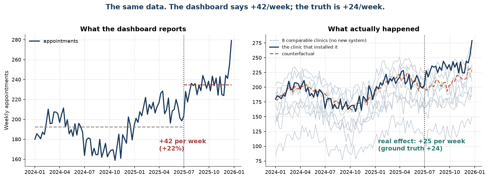

Same data, two answers. On the left, the before/after comparison a dashboard
would report: **+42 appointments per week**. On the right, eight comparable
clinics that installed nothing — they rose too. Once that shared movement is
removed, the real effect is **+25 per week**.

The ground truth, which we know because this is simulated data, is **+23.9**.
The dashboard was wrong by 77%.

---

## What it does

Takes a panel of outcomes before and after an intervention, builds a
counterfactual from control units, and reports the difference with an honest
uncertainty interval.

- **Four estimators**, each with different assumptions, so the result can be
  checked against a change of method:
  difference-in-differences · synthetic control · Bayesian counterfactual · interrupted time series
- **Uncertainty always.** Every estimate carries an interval, labelled with what
  kind it is — a frequentist confidence interval and a Bayesian credible
  interval are not the same claim.
- **Diagnostics that can fail.** Parallel-trends tests, placebo inference,
  pre-period back-tests. They cannot prove an estimate is right; they are
  designed to show when it is wrong.
- **Self-validating.** The package ships a Monte Carlo audit that inserts a known
  effect and measures whether each estimator recovers it. The
  [results are published below](#does-the-tool-actually-work), including the
  estimators that fail.
- **Plain-language reporting.** A multi-page PDF and a narrative layer that
  refuses to claim a direction when the interval crosses zero.
- **Interactive dashboard** for exploring the data and the assumptions.

---

## Quick start

```bash
git clone https://github.com/EthYusuf/impactlens.git
cd impactlens
pip install -e ".[app,dev]"
```

**See it work on a case with a known answer:**

```bash
impactlens demo --outdir outputs
```

```
==============================================================================
ImpactLens demo  |  ground-truth effect inserted: +23.90 per period (+11.3%)
==============================================================================
Difference-in-Differences        +24.92  [   +4.97,   +44.32]  err=  +1.02  truth in interval: yes
Synthetic Control                +24.98  [  +13.60,   +28.61]  err=  +1.09  truth in interval: yes
Bayesian Counterfactual          +25.66  [  +21.36,   +29.93]  err=  +1.76  truth in interval: yes
Interrupted Time Series          +42.04  [  +34.36,   +49.72]  err= +18.14  truth in interval: NO
Naive pre/post (benchmark)       +42.28  [  +35.52,   +49.03]  err= +18.38  truth in interval: NO
```

The three control-based estimators land within ~2 of the truth. The two that
have no control group report the market-wide shock as if it were the
intervention's doing.

**Analyse your own data:**

```bash
impactlens analyse examples/clinic_appointments.csv \
  --treated flagship_clinic \
  --date 2025-06-30 \
  --outcome-name "weekly appointments" \
  --pdf report.pdf
```

**Launch the dashboard:**

```bash
streamlit run src/impactlens/app/streamlit_app.py
```

**As a library:**

```python
from impactlens import PanelDataset, estimate_synthetic_control, headline

ds = PanelDataset.from_frame(
    df,                               # long format: unit, date, y
    treated_unit="flagship_clinic",
    intervention_date="2025-06-30",
)

est = estimate_synthetic_control(ds)

print(headline(est, outcome_name="appointments"))
# The intervention increased appointments by about 25.0 per period (+11.9%,
# interval +6.5% to +13.6%). The 95% placebo interval runs from 13.6 to 28.6
# and excludes zero.

for w in est.warnings:
    print("!", w)
```

### Input format

Long format, one row per unit per period:

| unit | date | y |
|---|---|---|
| flagship_clinic | 2024-01-01 | 181.4 |
| control_01 | 2024-01-01 | 139.8 |
| control_02 | 2024-01-01 | 226.1 |

The loader validates everything up front and fails with a message that says what
to fix — duplicate rows, unparseable dates, an intervention date outside the
data, too few pre-periods to characterise a baseline.

---

## Does the tool actually work?

On real data a causal estimate **cannot be checked**, because the counterfactual
is unobservable. On simulated data it can: the effect is inserted deliberately,
so the right answer is known.

Every estimator is run against **250 simulated datasets** containing a known
effect *and* a market-wide shock that starts on the intervention date — the
confound that breaks naive analysis.

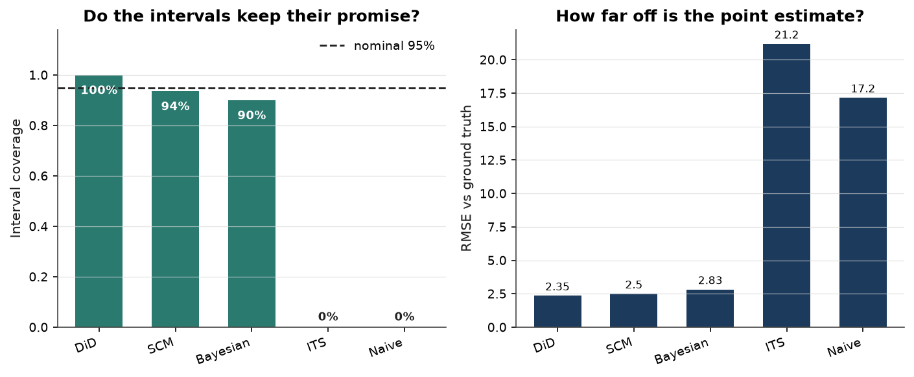

| Estimator | Bias | RMSE | **Interval coverage** | Power | Verdict |
|---|---:|---:|---:|---:|:---|
| Difference-in-Differences | +0.17 | 2.35 | **100.0%** | 98% | ✅ pass (conservative) |
| Synthetic Control | +0.19 | 2.50 | **93.6%** | 87% | ✅ pass |
| Bayesian Counterfactual | +1.00 | 2.83 | **90.0%** | 100% | ✅ pass |
| Interrupted Time Series | +20.88 | 21.19 | **0.0%** | 100% | ❌ overconfident |
| Naive pre/post | +17.03 | 17.17 | **0.0%** | 100% | ❌ overconfident |

*True effect: +23.97 per period. Nominal interval level: 95%.
Reproduce with `impactlens validate -n 250`.*

**Coverage is the column that matters.** It is the share of runs whose 95%
interval actually contained the true effect. It should land near 95%.
Materially below means the intervals are too narrow and the estimator is
claiming more certainty than it has earned — a worse failure than a noisy point
estimate.

Read the table honestly:

- **Synthetic control** is the best balance: near-zero bias, coverage on target,
  enough power to be useful.
- **Difference-in-differences** is *conservative*. Its wild cluster bootstrap
  produces intervals wide enough that coverage reaches 100% — it will rarely
  claim an effect that is not there, at the cost of wider ranges.
- **Interrupted time series and the naive comparison fail completely** — not
  because they are badly implemented, but because **neither has a control
  group**, so neither can distinguish the intervention from the market shock.
  They report the shock as the effect, with intervals that never contain the
  truth. They ship anyway, loudly warned, because showing the failure is the
  clearest possible argument for why the control-based methods matter.

### The failure is systematic, not bad luck

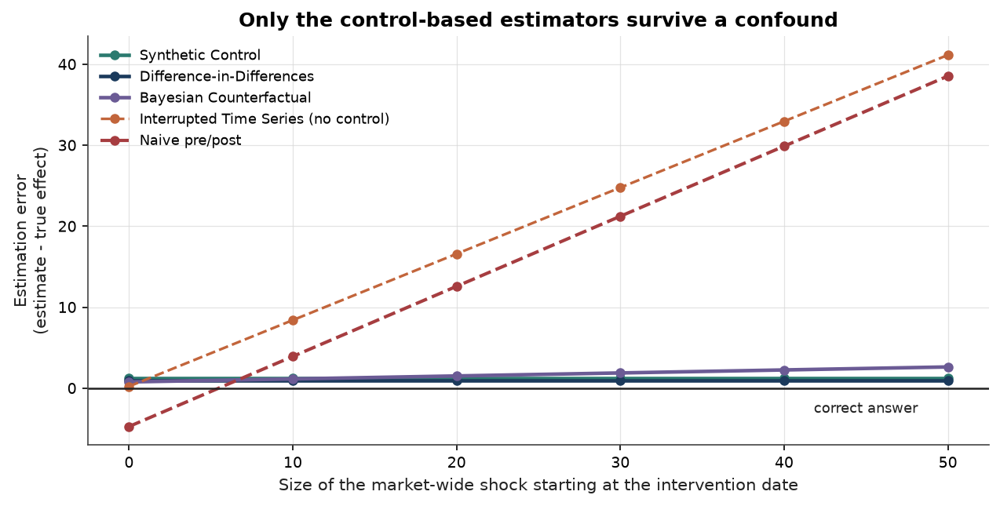

As the market-wide shock grows, the naive estimate's error grows with it,
one-for-one. The control-based estimators stay on the correct answer. This is the
single most informative picture in the project: the methods are not just more
accurate, they are *insensitive to the thing that breaks the alternative*.

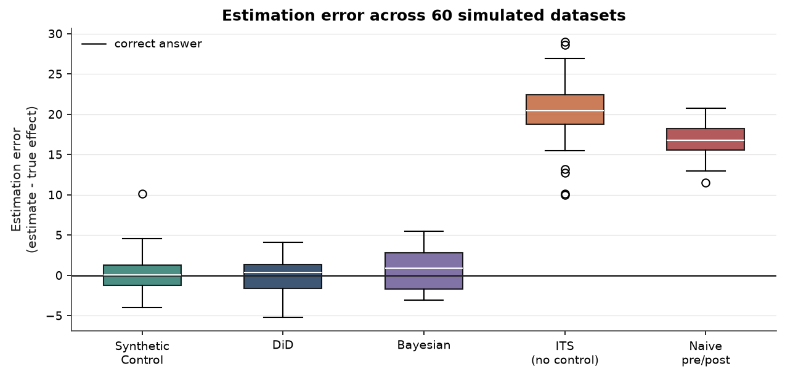

---

## Diagnostics: can this result be trusted?

### Parallel trends

Difference-in-differences assumes the treated unit would have moved parallel to
the controls. That is testable in the pre-period — and if it fails, the estimate
is biased.

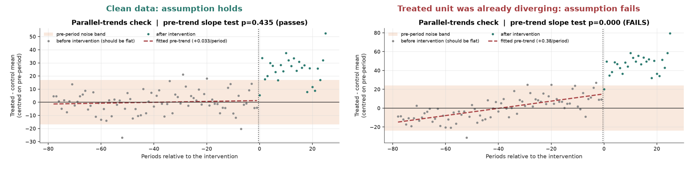

Left: clean data, the gap is flat, the assumption holds. Right: the treated unit
was already pulling away from its peers *before* the intervention — selection on
trend, the classic DiD killer. The test catches it and the estimator emits:

> The treated-minus-control gap was already drifting at +0.383 per period before
> the intervention (slope test p=0.0000). Parallel trends — the assumption this
> estimate depends on — looks violated, so the DiD number is likely biased.
> Prefer synthetic control, which fits the pre-period instead of assuming it away.

> [!NOTE]
> The textbook event-study regression is **not well posed with a single treated
> unit**, which is the normal case here. Each per-period interaction dummy is
> identified by one observation, and the joint F-test rejects far too often — on
> data where parallel trends holds by construction it returned p = 5×10⁻⁴.
> ImpactLens tests the treated-minus-control **gap slope** instead, which is
> correctly sized. Details in [docs/methodology.md](docs/methodology.md#parallel-trends-check).

### Placebo inference

Synthetic control's p-value comes from re-running the whole analysis pretending
each control unit was treated. If the treated unit's gap is unremarkable within
that distribution, the effect is noise.

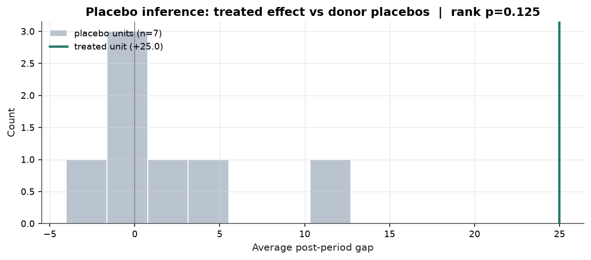

With `J` usable donors the smallest attainable p-value is `1/(J+1)`. With 8
donors that is 0.111 — and the tool **says so** rather than reporting a
precision the data cannot support.

### An interpretable counterfactual

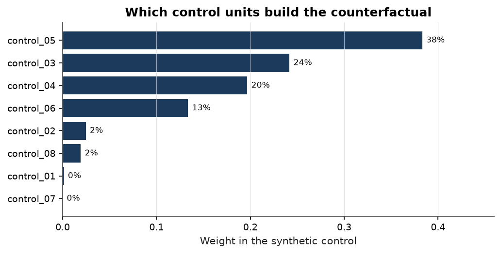

Weights are constrained to be non-negative and sum to one, so the comparison
unit is something you can describe to a client: *"62% control_03 + 38%
control_07"*, not a black box.

### Do the methods agree?

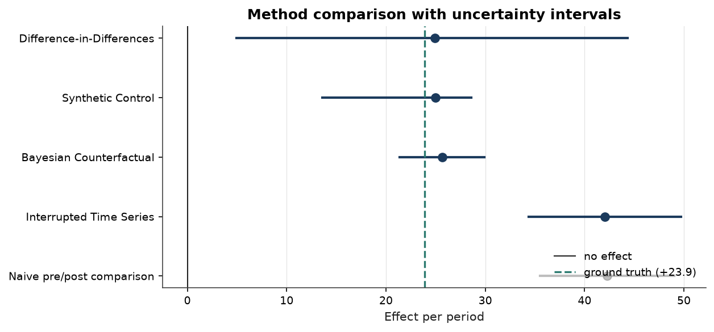

Agreement across methods means the finding comes from the data. Disagreement
means it comes from the assumptions — and the report says so instead of quietly
picking the most flattering number.

---

## The dashboard

Six tabs, in the order the question should actually be answered: read the
estimate, interrogate the diagnostics, compare the methods, audit the tool, then
export.

**Result** — the headline number, its interval, and a plain-language reading.
Because the demo has a known answer, the dashboard grades itself against it.

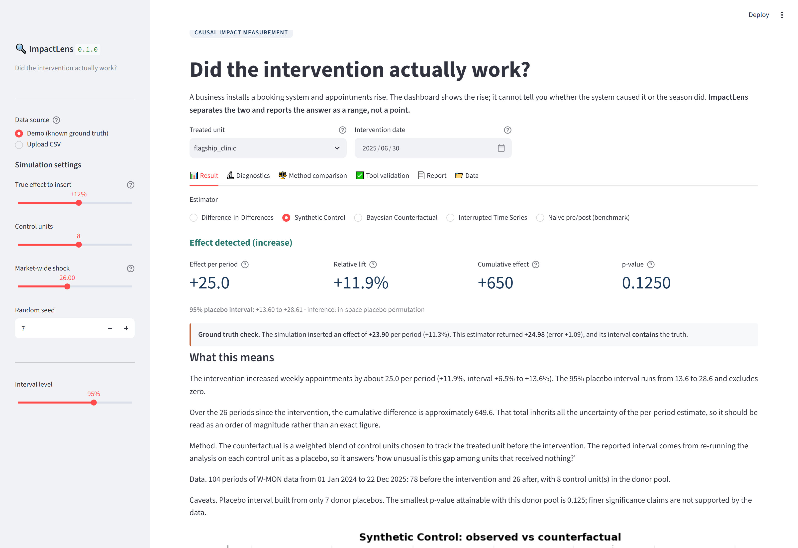

**Diagnostics** — the checks that could invalidate the result.

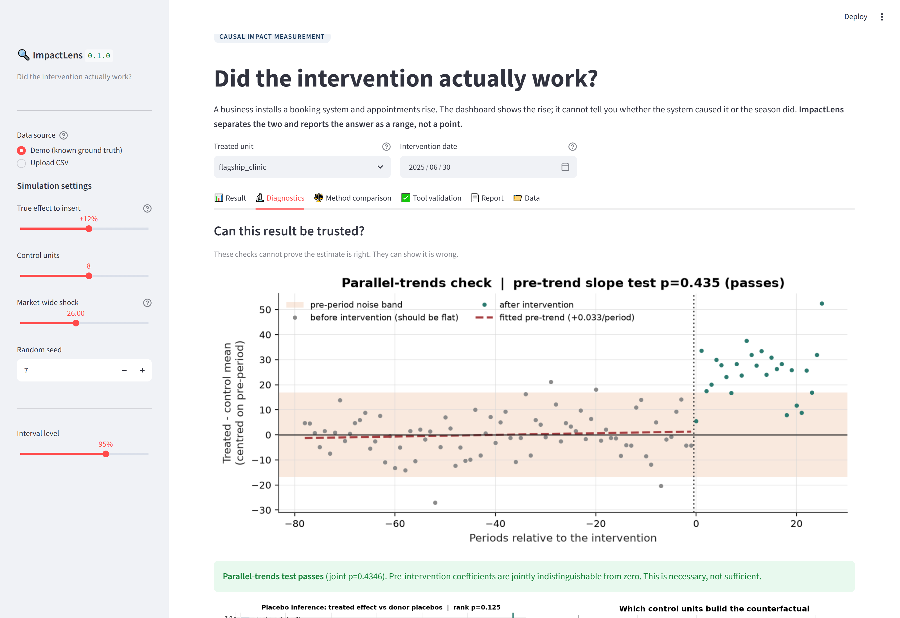

**Method comparison** — every estimator side by side, with the ground truth
marked and the naive benchmark shown for contrast.

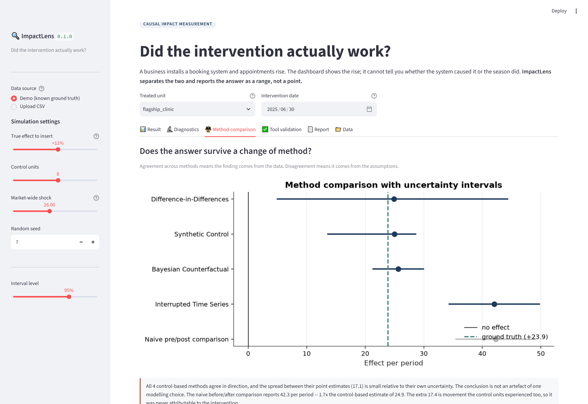

**Tool validation** — run the Monte Carlo audit from the browser.

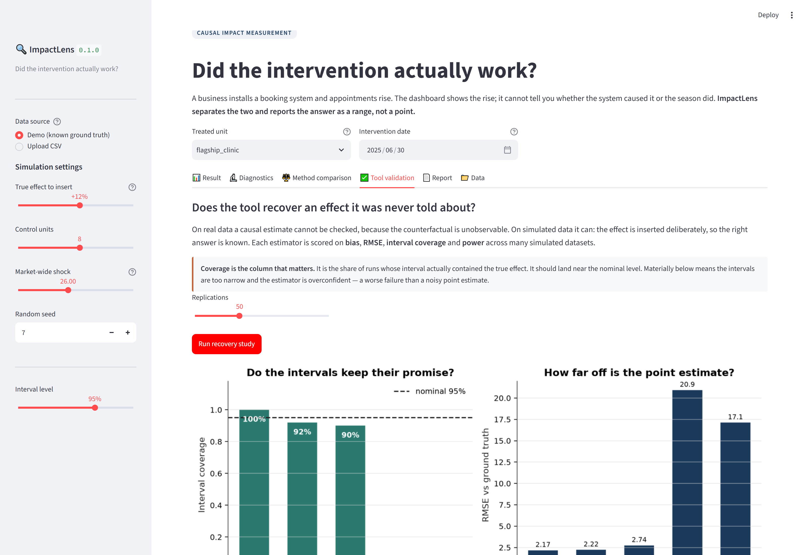

**Report** — generate the PDF.

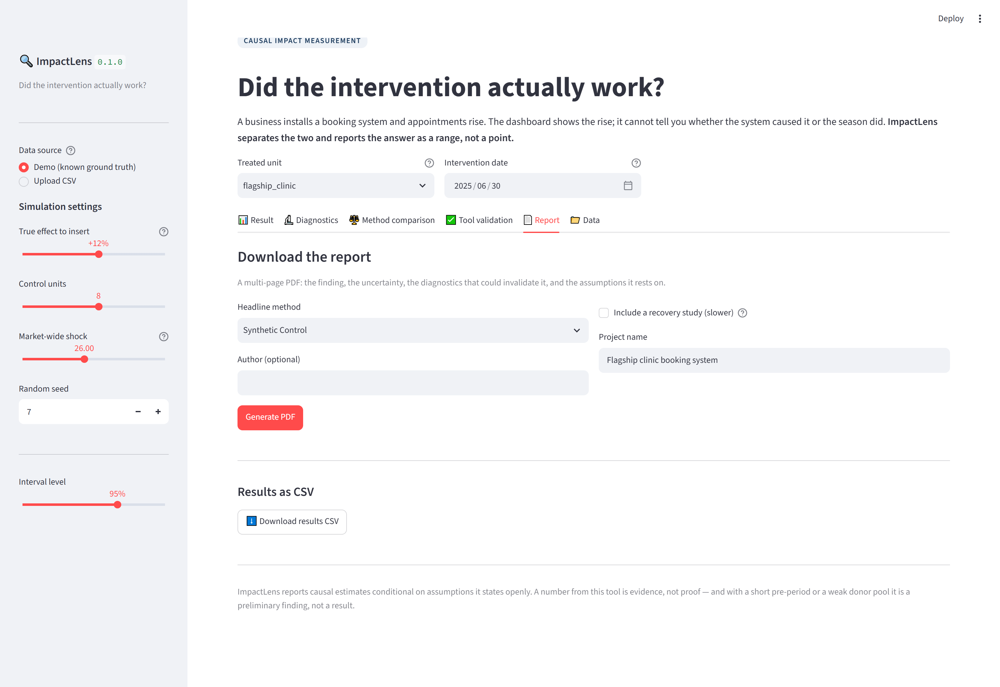

**Data** — the panel, its quality report, and the donor pool.

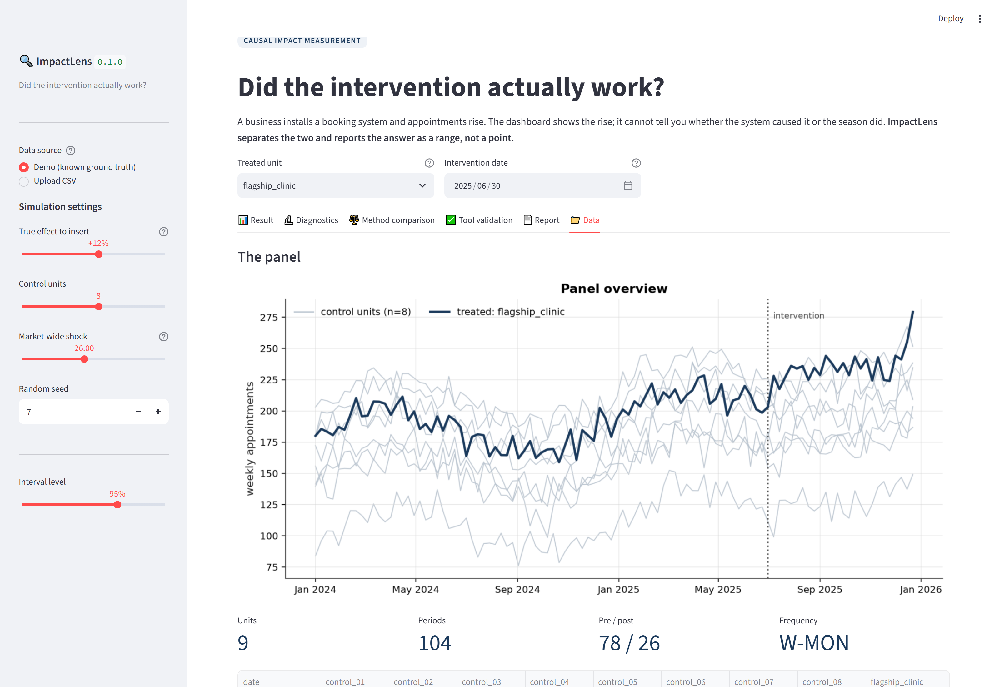

> Move the **Market-wide shock** slider and watch the naive estimate drift away
> from the truth while the control-based ones hold. Set **True effect** to 0% and
> check that the estimators correctly report nothing.

---

## The report

A multi-page PDF, ordered so the finding comes first and the things that could
invalidate it come immediately after — not buried in an appendix.

📄 **[See a sample report](docs/sample_report.pdf)**

1. **Cover** — the verdict, three headline numbers, and the analysis setup
2. **Executive summary** — what was found, in prose, with method and caveats
3. **The effect over time** — observed vs counterfactual, pointwise effect
4. **Accumulation and context** — cumulative effect, the full panel
5. **Diagnostics** — pre-trend check, placebo distribution, donor weights
6. **Method comparison** — every estimator, with a table
7. **Validation** — the recovery study, so a reader can judge the machinery
8. **Assumptions and limits** — what must be true, and when the tool is wrong

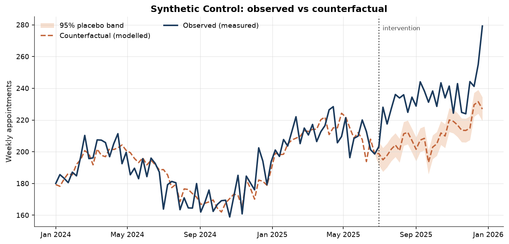

The counterfactual is always dashed and muted; the observation is solid. A
reader should never confuse a model output with a measurement.

---

## Honest limits

**Causal inference rests on assumptions. This section is not a disclaimer — it
is part of the product.**

The tool detects these for you and warns:

| Problem | How it is caught |
|---|---|
| Treated unit was already diverging | Pre-trend slope test |
| Counterfactual does not track the pre-period | Pre-fit ratio > 0.5 |
| Weights collapsed onto one donor | Effective donor count |
| Too few donors for real inference | p-value floor reported |
| Too few clusters for asymptotic SEs | Switches to wild cluster bootstrap |
| Residual autocorrelation | Durbin–Watson outside [1, 3] |
| Model manufactures effects | Pre-period placebo back-test |
| Pre- or post-period too short | Flagged as preliminary |

**These it cannot catch, and they are the dangerous ones:**

- **The treated unit was chosen *because* it was improving.** If the reason this
  unit adopted the intervention involves the outcome, every method here is
  biased upward and no modelling fixes it.
- **Spillover.** If your new website pulled customers away from the comparison
  clinics, their outcomes fell and the measured effect is too large.
- **Something else changed on the same date.** A price rise, two new hires, a
  press mention. All of it lands in the estimate.
- **The outcome was redefined.** A new system that counts appointments
  differently produces a level shift that is pure measurement artefact. This is
  the most common real-world explanation for a suspiciously clean jump.

👉 **Full treatment in [docs/assumptions.md](docs/assumptions.md).**

### Reporting standards

- Always report the interval, never the point estimate alone. "+12%" is not a
  finding; "+12% (95%: +4% to +20%)" is.
- When the interval crosses zero, say **"no detectable effect"** — not "a small
  positive effect". The narrative layer enforces this.
- Quote the strongest *applicable* method, not the most favourable one.
- With a thin pre-period or a weak donor pool, you have a **preliminary
  finding**, not a result.

### Client data

Never commit it. `.gitignore` blocks `data/raw/`, `data/private/` and `*.xlsx`,
but that is a safety net, not a policy. Get written permission, anonymise unit
names, aggregate to one row per unit per period, and keep the raw extract
outside the repository. If you cannot do all four, use the synthetic generator —
the methodology is what this project demonstrates.

---

## Project layout

```
impactlens/
├── src/impactlens/
│   ├── dataset.py              # panel validation, quality report, warnings
│   ├── simulate.py             # synthetic data with known ground truth
│   ├── validation.py           # Monte Carlo recovery + false-positive studies
│   ├── types.py                # ImpactEstimate, Interval
│   ├── cli.py                  # analyse / validate / demo
│   ├── estimators/
│   │   ├── did.py              # two-way FE + wild cluster bootstrap + pre-trend test
│   │   ├── synthetic_control.py# simplex weights + in-space placebo inference
│   │   ├── bayesian.py         # conjugate posterior + predictive intervals + back-test
│   │   ├── its.py              # segmented regression + Newey-West HAC
│   │   └── naive.py            # the benchmark that fails, shipped on purpose
│   ├── reporting/
│   │   ├── plots.py            # figures shared by dashboard, PDF and README
│   │   ├── narrative.py        # prose that refuses to overstate
│   │   └── report.py           # multi-page PDF
│   └── app/streamlit_app.py    # dashboard
├── scripts/
│   ├── make_assets.py          # regenerate every README figure
│   ├── capture_screenshots.py  # drive the live app with Playwright
│   ├── measure_bayesian_spec.py# the evidence behind a default
│   └── assert_calibration.py   # CI gate on interval coverage
├── tests/                      # 118 tests
├── docs/
│   ├── methodology.md          # the statistics, in full
│   ├── assumptions.md          # when this tool gives the wrong answer
│   └── sample_report.pdf
└── examples/clinic_appointments.csv
```

### Reproducing everything in this README

```bash
python scripts/make_assets.py --replications 250   # figures + validation table
python scripts/capture_screenshots.py              # live dashboard screenshots
python scripts/measure_bayesian_spec.py            # the specification table
pytest                                             # 118 tests
```

Every figure and number here is generated by a script in `scripts/`, so the
README cannot drift away from the code that produced it.

---

## Development

```bash
pip install -e ".[dev,app]"
pytest                    # 118 tests
ruff check .
impactlens validate -n 60 --csv-out validation.csv
python scripts/assert_calibration.py validation.csv
```

CI runs the test suite on Python 3.10–3.13, lints, runs the recovery study, and
**fails the build if interval coverage regresses**. A change that quietly
narrowed the intervals would pass every unit test — that gate is what catches it.

---

## References

- Abadie, Diamond & Hainmueller (2010). *Synthetic Control Methods for
  Comparative Case Studies.* JASA 105(490).
- Brodersen et al. (2015). *Inferring causal impact using Bayesian structural
  time-series models.* Annals of Applied Statistics 9(1).
- Cameron, Gelbach & Miller (2008). *Bootstrap-Based Improvements for Inference
  with Clustered Errors.* Review of Economics and Statistics 90(3).
- Bertrand, Duflo & Mullainathan (2004). *How Much Should We Trust
  Differences-in-Differences Estimates?* QJE 119(1).

---

## License

[MIT](LICENSE)

<div align="center">
<sub><b>ImpactLens reports causal estimates conditional on assumptions it states openly.</b><br>
A number from this tool is evidence, not proof.</sub>
</div>
